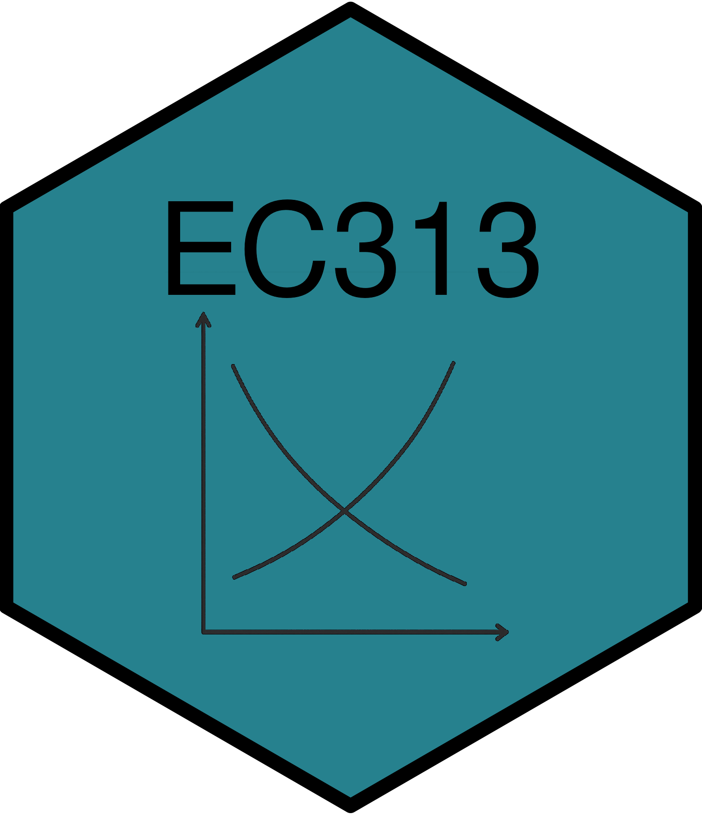

---
format:
  revealjs:
    theme: [default, hygge.scss]
    css: captions.css
    center-title-slide: false
    slide-number: true
    height: 900
    width: 1600
    chalkboard:
      theme: whiteboard
      src: drawings.json
editor: visual
---

<h1>Consumption Taxation</h1>

<hr>

<h2>EC313 - Public Economics: Taxation</h2>

<h2>Justin Smith</h2>

<h2>Wilfrid Laurier University</h2>

<h2>Fall 2026</h2>

{.absolute top="275" left="900" width="550"}

# Goals of This Section

## Goals of This Section

In this section we will:

- Describe the main types of [consumption taxes]{.fg style="color: #2780e3;"} in Canada
- Analyze the case for taxing consumption rather than income: administration, [efficiency]{.fg style="color: #2780e3;"} and&nbsp;[equity]{.fg style="color: #2780e3;"}
- Explain how a [value-added tax]{.fg style="color: #2780e3;"} works, including zero-rating and exemption
- Distinguish a [retail sales tax]{.fg style="color: #2780e3;"} from a value-added tax
- Summarize Canada's federal and provincial [excise taxes]{.fg style="color: #2780e3;"} and [customs duties]{.fg style="color: #2780e3;"}
- Weigh the advantages and disadvantages of a [personal consumption tax]{.fg style="color: #2780e3;"} over an income tax

::: {.notes}
The income tax base is potential consumption: Haig-Simons income is what you could consume plus what you add to your wealth (personal income tax deck). This deck is about taxing what people actually consume.

The finance minister who brought in the GST made the point that swapping a hidden tax for a visible, broad one would be unpopular, but that it had to be done. Keep that in mind for the "Improving the GST" slides: the visibility was deliberate, and it's part of why the GST is still unpopular.
:::

# Overview of Consumption Taxes

## Types of Consumption Taxes {.smaller}

- The income tax falls on what you *could* consume ([Chapter 17]{.fg style="color: #555;"}); these taxes fall on what you *do* consume

::: {.callout-important}
## General vs Selective
- [General sales taxes]{.fg style="color: #2780e3;"} apply to a broad base: the GST/HST, Quebec's QST, the provincial RSTs
- [Selective sales taxes]{.fg style="color: #2780e3;"} apply to particular goods: excises, customs duties
  - Also called excise taxes or [differential commodity taxes]{.fg style="color: #2780e3;"}
:::

- A sales tax can be a [unit tax]{.fg style="color: #2780e3;"} (cents per litre) or an [ad valorem tax]{.fg style="color: #2780e3;"} (a percentage of the price) ([Chapter 14]{.fg style="color: #555;"})
- Canada has four kinds
  - [VATs]{.fg style="color: #555;"}: the GST/HST (Ottawa and five provinces) and the QST (Quebec)
  - [RSTs]{.fg style="color: #555;"}: BC, SK and MB
  - [Excise taxes]{.fg style="color: #555;"}: Ottawa and every province
  - [Customs duties]{.fg style="color: #555;"}: Ottawa only

::: {.notes}
About 170 countries use a VAT. The US is the only industrialized country without one.
:::

## Consumption Tax Revenue

```{r echo=FALSE, fig.width=12, fig.height=4.6, dpi=150}
library(tidyverse)
library(scales)

taxrev <- read_csv("constaxrev2025.csv", show_col_types = FALSE) |>
  mutate(
    category = factor(category, levels = rev(unique(category))),
    government = factor(government, levels = c("Provincial and territorial", "Federal"))
  )

ggplot(taxrev, aes(x = revenue, y = category, fill = government)) +
  geom_col(position = position_dodge(width = 0.8), width = 0.75) +
  geom_text(aes(label = if_else(revenue > 0, number(revenue, accuracy = 0.1), "")),
            position = position_dodge(width = 0.8), hjust = -0.15, size = 4.5) +
  geom_text(data = filter(taxrev, category == "General sales taxes"),
            aes(x = 1.5, label = government, colour = government),
            position = position_dodge(width = 0.8), hjust = 0, size = 4.5,
            fontface = "bold") +
  scale_fill_manual(values = c("Federal" = "#2780e3",
                               "Provincial and territorial" = "#f0ad4e")) +
  scale_colour_manual(values = c("Federal" = "white",
                                 "Provincial and territorial" = "grey10")) +
  scale_x_continuous(limits = c(0, 100), breaks = seq(0, 100, 20),
                     expand = expansion(mult = c(0, 0.02))) +
  labs(x = NULL, y = NULL, subtitle = "Fiscal year 2024/25, $ billions") +
  theme_minimal(base_size = 16) +
  theme(
    legend.position = "none",
    panel.grid.major.y = element_blank(),
    panel.grid.minor = element_blank()
  )
```

- General sales taxes are most of the money, and the provinces collect more of it than Ottawa
- Only Ottawa levies customs duties; monopoly profits and motor vehicle taxes are almost all&nbsp;provincial

::: {.notes}
Source: Statistics Canada, tables 10-10-0016-01 (federal) and 10-10-0017-01 (provincial and territorial), reference year 2024, which is fiscal year 2024/25. The figures are preliminary. Import duties here are StatCan's \$6.2B; the tariffs slide uses Finance's Fiscal Reference Tables, which give \$6.3B for the same year. In all, about \$238B: \$95B federal and \$143B provincial and territorial. General sales taxes are \$151B of it, and the provinces collect 59% of that.

How the categories map: liquor and tobacco are the excise taxes only; liquor board, cannabis store and lottery profits are in monopoly profits (\$15.1B provincial, about \$0.1B federal). "Other" is cannabis excise, other excises, taxes on specific services such as insurance premiums and the air travellers charge, and other taxes on the use of goods. On the federal side most of "other" is a \$13.8B line for taxes on the use of goods, probably the federal fuel charge (not checked). StatCan doesn't report a federal motor vehicle line.

Caveat: StatCan's federal sales tax figure (\$61.4B) is about \$9B above the GST in the Public Accounts (\$52.5B). I haven't reconciled the two; StatCan's may be gross of the GST credit.

The book's picture is 2020/21: consumption taxes raised \$160B, and their share of consolidated government revenue has fallen from about 35% in 1965/66 to under a fifth. Monopoly profits were \$9.6B (2020). Cannabis brought in over \$100M federally and about \$400M provincially. Import duties were \$4.3B, down from about \$7B in 2018.
:::

# Reasons for Consumption Taxes

## Administrative Considerations

- The appeal is the small number of collection points
  - [Customs duties]{.fg style="color: #555;"}: at the border
  - [Excise taxes]{.fg style="color: #555;"}: from a few producers
  - [The old federal sales tax]{.fg style="color: #555;"} (1924): from manufacturers
- RSTs are collected from retailers: many more taxpayers, but far fewer than the income tax
- The base still needs arbitrary lines: one plain croissant is untaxed, one chocolate croissant is taxed, and six or more are untaxed (House of Commons, 1994)
- Evasion is real: the GST pushed some service work underground
- The case is strongest in less-developed countries, weaker where people keep good records

::: {.notes}
New in 2026: Manitoba (July 1) and Quebec (July 15) stopped applying provincial tax to single-serving sweet baked goods sold at grocery stores. The GST rule hasn't changed (CRA Memorandum 4.3).
:::

## Efficiency: The Saving Decision {.smaller}

<!-- Figure: the "Present Comsumption" axis typo is still in this image. Justin to fix saving2.ograph in Grapher and re-export for this deck and taxbehaviour. -->

:::: columns
:::: {.column width="45%"}

::::

:::: {.column width="55%"}
- The two-period model from last deck ([Chapter 18]{.fg style="color: #555;"}): one more dollar of $c_0$ costs $1 + r$ of $c_1$
- A 30% [income tax]{.fg style="color: #2780e3;"}, with interest deductible
  - Savers keep $0.70r$; borrowers pay $0.70r$
  - The price of $c_0$ falls to $1 + 0.70r$
  - That wedge between the market return and what people act on means an excess burden ([Chapter 15]{.fg style="color: #555;"})
- A [consumption tax]{.fg style="color: #2780e3;"} raising the same revenue leaves the price at $1 + r$: interest isn't taxed, only spending

::: {.callout-note}
## Where the Excess Burden Comes From
The substitution toward present consumption that the wedge causes, whether or not saving falls. Last deck showed saving can go either&nbsp;way
:::
::::
::::

::: {.notes}
The figure is Case I from the last deck: the black line is before the tax, the red line after it, rotating through the endowment point.

The book builds this on the life-cycle model (Chapter 11), with labour supply held fixed. The next slide drops that assumption. A consumption tax shifts the budget line in without changing its slope.
:::

## Efficiency: The Work Decision {.smaller}

- A consumption tax still taxes work
  - At a \$5 wage and a \$1 good, an hour of work buys 5 units; with a 25% sales tax, it buys 4
  - That's a wage cut, the same as a 20% income tax on wages ([Chapter 18]{.fg style="color: #555;"})
- The [substitution effect]{.fg style="color: #2780e3;"} toward leisure creates an excess burden, even if hours don't fall
- Both taxes distort something, so a consumption tax is not *necessarily* more&nbsp;efficient
  - Only evidence can say which one costs more

::: {.callout-note}
## What the Evidence Says
- Most studies find the consumption tax has the smaller excess burden, even counting labour supply (Feldstein, 2006)
- Switching to a broad proportional consumption tax raises long-run income about 7% in Canada (Economic Council of Canada, 1987) and about 9% in the US (Altig et al., 2001)
- Consumption is the least distorting provincial tax base (Dahlby and Ferede, 2015)
:::

::: {.notes}
Why 20% and not 25%: the sales tax rate is quoted on the price before tax, the income tax rate on the wage before tax. A sales tax at rate τ works like a tax on wages at τ/(1 + τ), here 0.25/1.25 = 0.20. It's the same arithmetic as the lifetime tax iClicker question (slide 15): a 25% tax on the price is a fifth of what is spent.

Dahlby and Ferede's Saskatchewan estimate: replacing \$10M of income tax with \$10M more sales tax gives a welfare gain of \$9.98M.

A tax at the same rate on every good still distorts the choice between goods and leisure (Chapter 15). That's why Corlett-Hague (Chapter 16) asks for higher rates on goods that go with leisure.
:::

## iClicker Question {background-color="#f0f4f8"}

A province replaces its income tax with a permanent sales tax that raises the same revenue. Which choices does the sales tax still&nbsp;distort?

A\) Neither: a sales tax only falls on spending\
B) Saving only: spending now costs more than spending later\
C) Both: spending in each period is taxed\
D) Work only: an hour of work buys fewer goods\
E) Work only, but with no excess burden if hours don't change

::: {.notes}
Answer: D. A permanent sales tax, at the same rate now and later, leaves the price of spending now, relative to spending later, at 1 + r, so saving isn't distorted. But it cuts what an hour of work buys, just like a wage cut, so the choice between work and leisure is still distorted.

E is the trap: the excess burden comes from the substitution effect toward leisure, so it's there even if hours don't change (last deck). A is the "no distortion" overclaim. B gets the saving distortion backwards: it's the income tax that changes the relative price, and it makes spending now cheaper, not dearer (1 + 0.70r, two slides back). C: taxing spending in both periods at the same rate leaves their relative price alone.
:::

## Equity: Progressiveness and Gender

:::: columns
:::: {.column width="50%"}
**Progressiveness**

- On annual income, sales taxes look regressive: lower-income households spend a larger share of what they&nbsp;earn
- Three caveats
  - Over a lifetime, the picture changes (two slides on)
  - The usual calculation assumes buyers bear the whole tax ([Chapter 14]{.fg style="color: #555;"})
  - Exemptions and refundable credits offset part of it
- The net effect is an open question
::::

:::: {.column width="50%"}
**Gender**

- Women and men buy different things
  - The GST came off feminine hygiene products on July 1, 2015
- The "pink tax": women paid more for 42% of comparable items and men for 18%, about 7% more on average (Bessendorf, 2015)
- A tax on the price carries that gap&nbsp;through
::::
::::

::: {.notes}
The book's example: a high-income person who consumes 70% of income pays a 10% consumption tax equal to 7% of income; a low-income person who draws down saving to consume 110% of income pays 11%. One study has consumption taxes falling from 14.0% of income in the lowest decile to 5.9% in the highest (Vermaeten, Gillespie and Vermaeten).

The credit: the GST credit became the Canada Groceries and Essentials Benefit in July 2026, raised 25% for five years. For 2026–27 the maximum is \$679 for a single person, \$890 for a couple and \$234 per child.
:::

## Equity: Ability to Pay {.smaller}

:::: columns
:::: {.column width="40%"}
| | Alex | Jordan |
|----------|----------:|----------:|
| Earns | \$200,000 | \$80,000 |
| Spends | \$60,000 | \$80,000 |

- At the same rate, an income tax takes 2.5 times as much from Alex as from&nbsp;Jordan
- A consumption tax takes *less* from Alex than from&nbsp;Jordan
::::

:::: {.column width="60%"}
- [For taxing income]{.fg style="color: #2780e3;"}: ability to pay is the *power* to consume
  - Alex could spend \$200,000, so Alex can afford to pay more
- [For taxing consumption]{.fg style="color: #2780e3;"}: tax what people take out of the economy, not what they put in
  - Jordan's spending uses up goods; Alex's saving pays for new&nbsp;capital
::::
::::

- Is saving taxed twice? Under an income tax, Alex's saved dollars are taxed when earned, and their interest is taxed&nbsp;again
  - Some call that double taxation; others say interest is new income like any other. It's a value judgment

::: {.notes}
The book's version (p. 379): a millionaire who saves most of their income could owe less consumption tax than a poorer person who spends everything.

"What they put in": income measures what people contribute to the economy through their work and saving. Consumption measures what they use up.

The double-taxation question is the next slide in numbers: under the income tax, Marge pays more than Homer in present value only because she saves.
:::

## Equity: Annual versus Lifetime {.smaller}

:::: columns
:::: {.column width="40%"}
- Homer and Marge each earn 100 now and nothing later; $r$ = 10%
  - Homer spends it all now; Marge consumes the same amount now and&nbsp;later
  - Both taxes take 50 from Homer
- A 50% [income tax]{.fg style="color: #2780e3;"}: Marge pays 51.11
  - The extra 1.11 (= 1.22/1.1) is the tax on her interest, which only savers&nbsp;pay
- A 100% [consumption tax]{.fg style="color: #2780e3;"} on the pre-tax price: half of every dollar spent is tax, now or later
  - Marge's spending is worth 100 today, so she pays 50.00, like Homer: [horizontal&nbsp;equity]{.fg style="color: #2780e3;"}
::::

:::: {.column width="60%"}
::: {style="font-size: 0.8em;"}
| | Homer, income&nbsp;tax | Marge, income&nbsp;tax | Homer, consumption&nbsp;tax | Marge, consumption&nbsp;tax |
|------------------------------|--------------:|--------------:|--------------:|--------------:|
| Income now | 100.00 | 100.00 | 100.00 | 100.00 |
| Tax now | 50.00 | 50.00 | 50.00 | 26.19 |
| Consumption&nbsp;now | 50.00 | 25.61 | 50.00 | 26.19 |
| Saving now | 0.00 | 24.39 | 0.00 | 47.62 |
| Interest later | 0.00 | 2.44 | 0.00 | 4.76 |
| Tax later | 0.00 | 1.22 | 0.00 | 26.19 |
| Consumption&nbsp;later | 0.00 | 25.61 | 0.00 | 26.19 |
| PDV of taxes | 50.00 | 51.11 | 50.00 | 50.00 |
:::
::::
::::

::: {.notes}
Where Marge's numbers come from. Income tax: she keeps 50 and earns 5% after tax on what she saves, so 50 = c + c/1.05 and c = 25.61. Consumption tax: each unit of consumption costs 2 with the tax, so 100 = 2c + 2c/1.1 and c = 26.19. PDVs: 50 + 1.22/1.1 = 51.11, and 26.19 + 26.19/1.1 = 50.00. "Now" and "later" here are c₀ and c₁ on slide 9.

A check students can run: for each person, the present value of consumption plus the present value of tax is 100. Marge under the income tax: 25.61 + 25.61/1.1 = 48.89, and 48.89 + 51.11 = 100. Under the consumption tax: 50.00 + 50.00. She also consumes more each period under the consumption tax (26.19 vs 25.61), because her saving earns the full 10%.

The book makes the same point with Ash and Brooklyn (Eqs 19.1–19.4): the present value of lifetime consumption tax doesn't depend on when people consume. With a rate t on the pre-tax price, as here, it's t/(1 + t) of lifetime income: 1/2 × 100 = 50.

More on lifetime: income fluctuates more than consumption, so annual income is a poor guide to who is well off. Davies, St-Hilaire and Whalley (1984) find general sales taxes roughly proportional to lifetime income. If bequests count as consumption at death, a consumption tax becomes a tax on lifetime income (fn 5). Uncertainty and borrowing limits weaken the lifetime argument.

Exercise 3 asks for the same comparison with different numbers.
:::

## iClicker Question {background-color="#f0f4f8"}

Priya and Sam each earn \$1,000 now and nothing later, and $r$ = 10%. A 25% sales tax is added to every price. Priya spends all \$1,000 now. Sam spends \$500 now (tax included) and the rest, with interest, next year. What is the present value of the tax each&nbsp;pays?

A\) Priya \$200; Sam about \$191\
B) Priya \$200; Sam \$200\
C) Priya \$200; Sam \$210\
D) Priya \$250; Sam \$250\
E) It depends on how much Sam values next year's spending

::: {.notes}
Answer: B. With a 25% tax on the pre-tax price, a fifth of every dollar spent is tax. Priya: \$200 now. Sam: \$100 now; his other \$500 grows to \$550, of which \$110 is tax, worth \$110/1.1 = \$100 today. Total \$200. A consumption tax takes the same present value whatever the timing of spending.

C is the trap: it adds \$100 and \$110 without discounting. D is the tax-exclusive slip: a 25% tax on the price is a fifth of what is spent, not a quarter. A discounts Sam's second \$100 without letting his saving earn interest, so it treats putting off spending as a tax saving. E: his preferences decide when he spends, not the present value of the tax.
:::

# Value-Added Taxes: GST and HST

## From the FST to the GST

- The [federal sales tax (FST)]{.fg style="color: #2780e3;"}, often called the MST, was levied on manufacturers
  - Its base was about a third of consumption, so it needed a high rate: 13.5% by 1990
  - Taxing inputs led to [tax cascading]{.fg style="color: #c7254e;"}

::: {.callout-important}
## Tax Cascading
Tax on inputs, then tax again on the goods made from them: the steel is taxed, then the car made with it
:::

- It also taxed exports through their inputs, and markups after manufacturing made effective rates vary
- The [GST]{.fg style="color: #2780e3;"} (1991, 7%): a broader base that includes services, with credits that end cascading and refund the tax on exports
- Cut to 6% (2006) and 5% (2008); six provinces later folded their RSTs into it, but BC voted its HST out in 2011

::: {.notes}
The FST also needed lines between manufacturing and distribution, which worked against domestic producers. Estimates of the gain from the switch (fn 8): Finance put GDP 1.5% higher; Hamilton and Whalley put the gain at 0.31% of GDP.

BC: former premier Bill Vander Zalm led the campaign against the HST, arguing it taxed more things than the PST did. That's the base-broadening point, from the other side.
:::

## How a Value-Added Tax Works {.smaller}

::: {.callout-important}
## Value Added
Sales minus purchases of material (intermediate) inputs. Wages, interest, rent and profit are all part of value&nbsp;added
:::

| Producer | Purchases (\$) | Sales (\$) | Value added (\$) | VAT at 10% (\$) |
|---|---:|---:|---:|---:|
| Farmer | 0 | 400 | 400 | 40 |
| Miller | 400 | 700 | 300 | 30 |
| Baker | 700 | 950 | 250 | 25 |
| Grocer | 950 | 1,000 | 50 | 5 |
| Total | | | 1,000 | 100 |

- A [value-added tax (VAT)]{.fg style="color: #2780e3;"} is a percentage tax on each stage's value added
  - Total value added is \$1,000, the retail price, so the VAT raises \$100: the same as a 10% tax on the final sale
- Sales and purchases are before tax: each firm charges 10% on top, and gets back what it paid on its purchases as a&nbsp;credit

## iClicker Question {background-color="#f0f4f8"}

With a 5% GST, a furniture maker buys \$2,000 of wood (plus GST) and sells \$5,000 of tables (plus GST). How much GST does the furniture maker send to the&nbsp;government?

A\) \$0, since only the store that sells to consumers remits\
B) \$100\
C) \$150\
D) \$250\
E) \$350

::: {.notes}
Answer: C. It remits 5% of its \$3,000 of value added: \$150. In practice it gets there by charging \$250 on its sales and claiming a credit for the \$100 it paid on the wood (the invoice-credit method, next slide).

D is the trap: it taxes all \$5,000 of sales, forgetting that the \$2,000 of wood was already taxed, so tax would pile on tax at each stage. A confuses the GST with a retail sales tax. B is the credit itself. E adds the tax paid to the tax charged instead of subtracting it.
:::

## Implementation Issues: Investment Goods and Collection {.smaller}

:::: columns
:::: {.column width="50%"}
**Investment goods**

::: {.callout-important}
## Three Types of VAT
What can a firm deduct when it buys investment goods?

- The full cost: a [consumption-type VAT]{.fg style="color: #2780e3;"}
- Depreciation only: a [net income-type VAT]{.fg style="color: #2780e3;"}
- Nothing: a [gross income-type VAT]{.fg style="color: #2780e3;"}
:::

- The GST is consumption-type: GST paid on equipment is credited right away
::::

:::: {.column width="50%"}
**Collection**

- The [invoice-credit method]{.fg style="color: #2780e3;"}: each firm owes tax on its total sales, less a credit for the tax on its purchases, backed by invoices
  - The baker: 10% × \$950 = \$95, less \$70 = \$25, which is 10% of its value added
- Buyers police their sellers: no invoice, no credit
- Collusion and false invoices still happen, though collecting at every stage has cut fraud
::::
::::

::: {.notes}
Tait (1988) is sceptical that the invoice system enforces itself (fn 11). There's also less to gain from evading on the final sale, since most of the tax has been collected by then.

The credits aren't free: they add compliance work, especially for small firms. More on that under Improving the GST.
:::

## Implementation Issues: The Rate Structure

- Zero-rated (taxed at 0%): basic groceries, prescription drugs, medical devices, feminine hygiene products, and exports
  - Zero-rating exports makes the GST [destination-based]{.fg style="color: #2780e3;"}
- Lighter treatment: childcare, dental care
- Small suppliers, with under \$30,000 in sales, need not register
- Hard to tax: financial services (value added is hard to measure) and owner-occupied housing ([Chapter 17]{.fg style="color: #555;"})
- Uneven rates add complexity. Can they be justified?

::: {.notes}
The \$30,000 threshold hasn't changed; it's \$50,000 for public service bodies.

New housing: the first-time home buyers' GST rebate is up to \$50,000 on new homes up to \$1M, phased out by \$1.5M (Bill C-4, 2026). CRA and Finance give different start dates. The older new-housing rebate is in the book's fn 16.
:::

## Should Rates Differ? {.smaller}

::: {.callout-note}
## Atkinson and Stiglitz (1980)
If the income tax is set optimally, and leisure is separable from goods, differential commodity taxes can't raise welfare
:::

- If the income tax isn't optimal, taxing luxuries more and necessities less can help on equity grounds
  - That may be why food is zero-rated
- But many high-income families spend a lot on food, and equity is better handled by the income tax and a refundable credit
  - That was the finance minister's own case for the GST credit, which offset the GST's added regressivity
  - Today's version is the Canada Groceries and Essentials Benefit
- Uniform rates aren't optimal either when goods differ in how they go with leisure: Corlett-Hague ([Chapter 16]{.fg style="color: #555;"})

::: {.notes}
Separability (fn 12): how people trade off one good against another doesn't depend on how much leisure they have.

The minister's argument (Wilson, Department of Finance, 1987, p. 64), roughly: exempting food helps everyone who buys food, rich or poor, while a refundable credit can be aimed at low-income families.
:::

## Zero-Rated versus Exempt {.smaller}

::: {.callout-important}
## Zero-Rated vs Exempt
- [Zero-rated]{.fg style="color: #2780e3;"}: taxed at 0%, and the seller still claims credits for the tax on its inputs
- [Exempt]{.fg style="color: #2780e3;"}: no tax charged, and no credits
:::

:::: columns
:::: {.column width="58%"}
| Bread, 10% GST (\$) | Taxed | Zero&#8209;rated | Exempt |
|------------------------|------:|------:|------:|
| Farmer, miller, baker remit | 95 | 95 | 95 |
| Grocer charges the shopper | 100 | 0 | 0 |
| Grocer's credit for GST paid | 95 | 95 | 0 |
| Grocer remits | 5 | −95 | 0 |
| **Total GST** | **100** | **0** | **95** |
| Shopper pays | 1,100 | 1,000 | 1,095 |
::::

:::: {.column width="42%"}
- The farmer, miller and baker are unaffected: they remit \$95 in all three&nbsp;cases
- [Zero-rated]{.fg style="color: #2780e3;"}: the grocer's −95 is a refund of the GST it paid the baker. It still keeps its \$50 of value added, just as when bread is&nbsp;taxed
- [Exempt]{.fg style="color: #2780e3;"}: the grocer can't claim back the \$95, so it passes it on in the price of&nbsp;bread
::::
::::

::: {.notes}
The first two panels of the book's table, using the bread example. Each upstream stage charges GST, claims a credit for the GST it paid, and remits the difference: 40 + 30 + 25 = \$95, whatever happens at the grocer.

Zero-rated: the grocer charges no GST but still claims the \$95 it paid the baker, so CRA refunds it and the total is \$0. The refund isn't a windfall. When bread is taxed the grocer charges \$1,100, pays the baker \$1,045 and remits \$5, keeping \$50. Zero-rated, it charges \$1,000, pays \$1,045 and gets \$95 back: still \$50. The whole \$100 goes to the shopper.

Exempt: the grocer charges nothing and claims nothing, so the \$95 is a cost like any other input. Passed on, bread costs \$1,095.

Zero-rating isn't free to run: zero-rated sellers are always owed refunds, which ties up their cash and draws CRA's attention, since refund claims are a common target for fraud.
:::

## Exempting a Middle Stage {.smaller}

:::: columns
:::: {.column width="50%"}
| GST remitted (\$) | Everything taxed | Flour exempt |
|------------|------------:|------------:|
| Farmer | 40 | 40 |
| Miller | 70 − 40 = 30 | 0 |
| Baker | 95 − 70 = 25 | 95 − 0 = 95 |
| Grocer | 100 − 95 = 5 | 100 − 95 = 5 |
| **Total** | **100** | [**140**]{.fg style="color: #c7254e;"} |
::::

:::: {.column width="50%"}
- The exempt miller charges no GST and can't claim back the \$40 it paid
- The baker's flour invoice shows no GST, so it has no credit: it remits 10% of its full \$950 of&nbsp;sales
- That \$95 covers the farmer's, the miller's and the baker's value added, so the farmer's is taxed twice:&nbsp;[cascading]{.fg style="color: #c7254e;"}
::::
::::

- Exempting the miller doesn't even untax the miller: its value added is taxed at the baker instead
- Exempt under the GST: residential rent, most health and dental care, daycare, municipal transit, most education, many financial services

::: {.notes}
The third panel of the book's table. Like the book, it holds each stage's pre-tax price fixed. If the miller passed its \$40 on, flour would cost \$740 and the total would be \$144, since the \$40 itself gets taxed again at the baker.

The real-world middle-stage case is financial services sold to businesses: the bank can't claim credits, so the GST it pays is buried in its fees, and its business customers can't claim it back.
:::

## iClicker Question {background-color="#f0f4f8"}

A 10% VAT. A farmer sells wool to a spinner for \$200, the spinner sells yarn to a knitter for \$500, and the knitter sells sweaters to shoppers for \$800. If yarn is made exempt, how much VAT is collected in&nbsp;total?

A\) \$20\
B) \$50\
C) \$80\
D) \$100\
E) \$150

::: {.notes}
Answer: D. The farmer remits \$20. The exempt spinner charges nothing and can't claim back the \$20 it paid. The knitter charges \$80 and, with no VAT on the yarn invoice, has no credit to claim, so remits all \$80. Total \$100, against \$80 with no exemption: exempting a middle stage raises the tax because it breaks the credit chain.

B is the trap: it assumes the exemption just removes the spinner's \$30 of tax on its value added, giving \$80 − \$30. C assumes a VAT always collects 10% of the final price. E taxes every sale in full, with no credits: \$20 + \$50 + \$80. A assumes an exempt input makes everything after it exempt too.
:::

## Improving the GST: Harmonization and Compliance

- Economists like the GST; voters don't
  - The Liberals promised to repeal it
- [Harmonization]{.fg style="color: #2780e3;"}: one base and one return, which lowers compliance costs
  - The HST came to NL, NS and NB (1997), ON (2010) and PE (2013)
  - BC had it from 2010 to 2013
  - Quebec integrated its QST with the GST but runs it itself
- [Compliance]{.fg style="color: #2780e3;"}: tracking credits and exempt items is costly, and hardest on small&nbsp;firms

::: {.notes}
The repeal promise came in the 1993 campaign. The book says the Liberals were "elected in 1994"; the election was October 1993.

Public bodies (municipalities, universities, schools and hospitals, the MUSH sector) get rebates of part of the GST they pay. The HST is collected federally and the QST by Quebec, nearly fully harmonized with the GST since 2013 (fn 17).

2026 HST rates: 15% in NL, PE and NB; 14% in NS since April 1, 2025; 13% in ON.
:::

## Improving the GST: Other Proposals

- [Broaden the base]{.fg style="color: #2780e3;"}: taxing groceries would cut compliance costs and allow a lower rate, but it's politically hard
- [Tax-inclusive pricing]{.fg style="color: #2780e3;"}: *consumers* say they prefer it; economists want the tax visible
  - The GST was made visible on purpose, and that's part of why it's unpopular
- Does a VAT help government grow, since it raises a lot of money with little notice?

::: {.notes}
The book's footnote 21 discusses Denmark on the growth-of-government question.

Other issues: cross-border shopping; GST/HST on imported digital subscriptions since 2021. Canada's 3% digital services tax was rescinded in June 2025 and repealed by Bill C-15 (March 2026).
:::

## The 2024–25 GST/HST Holiday

- December 14, 2024 to February 15, 2025: no GST/HST on
  - Food and restaurant meals, children's clothing, diapers, car seats and toys
  - Books and newspapers, video games and consoles, Christmas trees, and beer and wine
- Cost: about \$1.6B federally (Finance; the PBO says \$1.5B), plus up to \$1.3B of provincial HST
- It ran the other way from the last two slides: a narrower base, with new lines to draw
  - Retailers reprogrammed their tills and checked inventory line by line (CTV News, February&nbsp;2025)

::: {.notes}
Link back to the croissant rule: the holiday drew a new set of lines, such as beer and wine in but spirits out.

The CTV News report (Allison Bamford, February 14, 2025): some stores spent hundreds of hours going through inventory item by item, some spent over \$1,000 on IT help, and owners said customers thought the break applied to everything. Its verdict was that the holiday may have helped some consumers but was a flop for many small businesses.
:::

# Provincial General Sales Taxes

## RST versus VAT

- RSTs came first: Alberta in 1936 (repealed in 1937), Saskatchewan in 1937, and every province but Alberta by 1967
- Today only BC, SK and MB have [retail sales taxes]{.fg style="color: #2780e3;"}
  - Quebec's QST and the HST are VATs integrated with the GST
  - Alberta and the territories have no general sales tax

::: {.callout-note}
## Equivalence Conditions
An RST and a VAT are the same if they have the same rate and base, the RST falls only on final sales, and the VAT is consumption-type
:::

- The bread: a 10% RST at the grocer raises \$100, the same as the four VAT payments

::: {.notes}
The first RSTs were 2%. BC, Quebec, Newfoundland and Nova Scotia had RSTs by 1950.
:::

## Where RSTs and VATs Differ

- A VAT collects small amounts from many firms; an RST collects one large amount at the till
- The VAT's invoices leave a paper trail; the RST leaves none
- Exempting a small grocer costs a VAT only that grocer's \$5 (10% of its \$50 value added), but costs an RST the whole \$100
- The RST is easier to understand and has fewer collection points
- But RSTs fall on business inputs, which brings back [tax cascading]{.fg style="color: #c7254e;"}
  - Bird and Smart (2009): investment rose in QC, NL, NS and NB after they switched to a VAT

::: {.notes}
The small-grocer numbers are mine, from the bread example: under a VAT, the \$95 collected at earlier stages is still collected if the grocer is exempt; under an RST, the grocer is the only collection point.
:::

## iClicker Question {background-color="#f0f4f8"}

A province with a 10% sales tax exempts small retailers. A corner store buys \$150,000 of goods from wholesalers and sells them for \$200,000. How much revenue does the province lose on this&nbsp;store?

A\) \$20,000 under either tax\
B) \$5,000 under either tax\
C) \$20,000 under a VAT; \$5,000 under an RST\
D) \$15,000 under a VAT; \$20,000 under an RST\
E) \$5,000 under a VAT; \$20,000 under an RST

::: {.notes}
Answer: E. Under a VAT, the \$15,000 on the store's purchases was already collected at earlier stages, and the exempt store can't claim it back; only the tax on its \$50,000 of value added is lost. Under an RST, the retail sale is the only point of collection, so the whole \$20,000 goes.

A is the trap: the two taxes raise the same revenue on the same base, but they collect it at different points, so an exemption costs different amounts. D counts the \$15,000 already collected as lost. C reverses the two. B misses that an RST collects nothing before the retail sale.
:::

## Sales Tax Rates, 2026

| | Tax | Provincial rate | With GST |
|---|---|---:|---:|
| NL, PE, NB | HST | 10% | 15% |
| NS | HST | 9% | 14% |
| ON | HST | 8% | 13% |
| QC | QST | 9.975% | 14.975% |
| BC | PST (RST) | 7% | 12% |
| MB | RST | 7% | 12% |
| SK | PST (RST) | 6% | 11% |
| AB, territories | none | — | 5% |

- The first RSTs charged 2%

::: {.notes}
NS cut its provincial part from 10% to 9% on April 1, 2025.

The book's 2020/21 revenue figures: RST/HST revenue per person (Table 19.3) ranged from \$2,139 in NL to \$1,475 in BC; Alberta, with no sales tax, still raised \$4.4B from consumption taxes; consumption taxes were about 20% of provincial revenue.

Gas taxes in 2026 (¢/L): NL 7.5 (cut made permanent in April 2026; a bill to go to zero is unconfirmed); ON 9.0; MB 12.5; AB 0 for October–December 2026; PE suspended to January 31, 2027 (news reports only); NS, NB, QC and SK unchanged, on one secondary source. Territories not checked.

Tobacco rates are left off: PE and NL aren't verified, and the sources for AB and QC disagree.
:::

## Provincial Sales Tax Bases

- [Food]{.fg style="color: #555;"}: every province exempts most food; prepared meals are taxed in MB and SK, not in BC
- [Children's clothing]{.fg style="color: #555;"}: exempt in BC, and in MB up to \$150; taxed in SK since April 2017
  - The book says it's exempt everywhere, which is out of date
- [Services]{.fg style="color: #555;"}: mostly left out of RST bases, which saves administration and compliance costs, but has no basis in theory and tilts spending toward services
- [Business inputs]{.fg style="color: #555;"}: RSTs, like the old FST, still tax many, so [tax cascading]{.fg style="color: #c7254e;"} remains
- HST and QST provinces use the broader GST base
  - Ontario rebates its 8% at the till on children's clothing, books, diapers, car seats, newspapers and prepared food of \$4 or less
- BC widened its base on October 1, 2026: cable, landlines and clothing repair

::: {.notes}
BC's planned PST on professional services was paused in September 2026. The book's list of services usually in RST bases: phone service, cable TV, hotel rooms and dry cleaning.

Quebec is left off this slide: the QST is a VAT, not an RST, and its treatment of children's clothing is only partly verified.
:::

# Excise Taxes and Customs Duties

## Customs Import Duties

::: {.callout-important}
## Customs Duties
Taxes on imports. Only Ottawa can levy them (Constitution Act, 1867)
:::

- At Confederation they raised \$9M, 75% of federal revenue; in 2020–21, \$4.3B, or 1.4%
- Trade agreements (GATT/WTO, NAFTA, CPTPP, CETA)
  - The average tariff is 3.4%
- Even without a trade agreement, about half of agricultural products and nearly 40% of others can enter duty-free
- Tariffs now serve development or foreign-policy goals, not revenue
  - Dairy shows it: tariffs averaging 249% (2019) keep imports out

::: {.notes}
The WTO figures (3.4%, 249%, 2019) are the book's and weren't rechecked.
:::

## Tariffs Return, 2025–26

:::: columns
:::: {.column width="45%"}
```{r echo=FALSE, fig.width=6, fig.height=5.2, dpi=150}
library(tidyverse)
library(scales)

customs <- read_csv("customs.csv", show_col_types = FALSE) |>
  mutate(year = fct_inorder(year))

ggplot(customs, aes(x = year, y = duties)) +
  geom_col(fill = "#2780e3", width = 0.7) +
  geom_text(aes(label = number(duties, accuracy = 0.1)), vjust = -0.5, size = 5) +
  scale_y_continuous(limits = c(0, 11.5), breaks = seq(0, 10, 2),
                     expand = c(0, 0)) +
  labs(x = NULL, y = NULL, subtitle = "Federal customs import duties, $ billions") +
  theme_minimal(base_size = 16) +
  theme(
    legend.position = "none",
    panel.grid.major.x = element_blank(),
    panel.grid.minor = element_blank()
  )
```
::::

:::: {.column width="55%"}
- 2025: counter-tariffs on US goods
  - 25% on \$30B in March, then \$29.8B more, then&nbsp;autos
  - Most came off on September 1, 2025, except steel, aluminum and autos
- Customs revenue went from \$6.3B (2024–25) to \$10.3B (2025–26), up 64%
- September 8, 2026: new surtaxes of 15–50% on \$27.6B of US goods; steel and aluminum surtaxes up to 50%
- A tariff is a tax on imports, and who bears it depends on elasticities ([Chapter 14]{.fg style="color: #555;"})
::::
::::

::: {.notes}
Source for the chart: Department of Finance, Fiscal Reference Tables 2026.

The September 2026 surtaxes (SOR/2026-186) match the US tariffs dollar for dollar. Steel tariff-rate quotas were extended to June 27, 2027.
:::

## Excise Taxes {.smaller}

::: {.callout-important}
## Excise Taxes
Selective taxes on particular goods, levied by Ottawa and every province. Most are unit taxes, but some are ad valorem
:::

| Good | Federal rate, 2026 |
|----------------------|----------------------------------------------------|
| Gasoline | 10¢/L, suspended since April 20, 2026; half rate February 1 – March 31, 2027 |
| Cigarettes | \$38.92 per carton |
| Spirits | \$14.12 per litre of alcohol |
| Wine over 7% alcohol | 74.5¢ per litre |
| Beer over 2.5% alcohol | \$37.69 per hectolitre |
| Cannabis | The greater of \$1/g or 10% (shared with the provinces) |
| Luxury tax, cars over \$100,000 | The lesser of 10% of the price or 20% of the amount over \$100,000 |

- The last two rows include ad valorem rates; the rows above them are unit taxes

::: {.notes}
Diesel and aviation fuel: 4¢/L, suspended on the same schedule, with full rates on both fuels from April 1, 2027 (Bill C-38). The suspension costs \$5.3B in 2026–27.

Tobacco rates rise with the CPI each April. Alcohol rates rise 2% a year under a cap; extending the cap two more years is only proposed (Bill C-30, status not checked).

The federal share of cannabis revenue was capped at \$100M for the first two years only. Vaping: \$1.12 per 2 mL for the first 10 mL. The luxury tax dropped aircraft and boats from November 2025. The book's 10% federal tax on insurance premiums is another ad valorem excise.
:::

## Why Tax Particular Goods? {.smaller}

- [Revenue and ease]{.fg style="color: #555;"}: there are only a few producers to collect from
  - But high rates invite smuggling: tobacco taxes rose 48% in four years, smuggling took off in 1993–94, and rates were cut
- [Externalities]{.fg style="color: #555;"}: gasoline, tobacco, alcohol ([Chapter 5]{.fg style="color: #555;"}, next deck)
  - Smokers' earlier deaths offset part of their health costs, and second-hand smoke may be better handled by limits on where people smoke
- [Luxuries]{.fg style="color: #555;"}: tax what the rich buy, for distribution, as the luxury tax does
- [User charges]{.fg style="color: #555;"}: the gas tax stands in for a fee for using the roads
- [Sin taxes]{.fg style="color: #555;"}: the state imposing its own preferences
  - That's outside standard welfare economics, and the flip side of merit goods

## In the News: Taxing Gasoline

- Federal gas tax money goes to cities: the Canada Community-Building Fund, over \$2B a year to about 3,600 communities
  - TransLink, Metro Vancouver's transit authority, levies its own 18.5¢/L
- Wood (2015): an efficient gas tax for the Toronto region would be about 15¢/L above the existing 40.57¢ (2006 prices), to cover congestion, pollution and other costs
- Gas taxes are easy to cut and hard to raise
  - France's protests in 2018
  - Canada's consumer carbon charge, at zero since April 2025
  - The federal fuel excise, suspended since April 2026
- Next deck: how to set a tax on an externality ([Chapter 5]{.fg style="color: #555;"})

::: {.notes}
Part 1 of the Greenhouse Gas Pollution Pricing Act, the consumer fuel charge, was repealed by Bill C-4 (March 2026). Industrial carbon pricing continues.
:::

## iClicker Question {background-color="#f0f4f8"}

Which argument supports a tax on gasoline but not a tax on&nbsp;cigarettes?

A\) It is cheap to collect from a few producers\
B) It charges people for using the roads\
C) It makes buyers pay for harm they do to others\
D) It discourages a habit the government disapproves of\
E) It collects more from high-income households

::: {.notes}
Answer: B. The gas tax stands in for a user charge on the roads; nothing like that applies to cigarettes.

C is the trap: both goods harm others (pollution and congestion, second-hand smoke), so the externality argument fits both. A fits both too. D is a sin tax, which fits cigarettes rather than gasoline, and sits outside standard welfare economics. E is the luxury argument, which fits neither: neither good is a luxury.
:::

# Personal Consumption Taxes

## The Basics

- Sales taxes have their legal (statutory) incidence on firms ([Chapter 14]{.fg style="color: #555;"}), so they can't take a person's circumstances into account
- A [personal consumption tax]{.fg style="color: #2780e3;"}, also called a [personal expenditure tax]{.fg style="color: #2780e3;"}: each household files a return on its annual consumption
  - Exemptions, deductions (say, for large medical bills) and rising rates are all possible

::: {.callout-important}
## The Personal Consumption Tax Base
Consumption = income − change in net wealth. Compare Haig-Simons: income = consumption + change in net wealth ([Chapter 17]{.fg style="color: #555;"}). Saving is left out
:::

- The best-known version is the Hall-Rabushka flat tax (two slides on)

::: {.notes}
Some argue Canada could get there by extending the rules for RPPs and RRSPs (fn 24).
:::

## Measuring the Base

:::: columns
:::: {.column width="50%"}
**Add**

- Wages and other income (not capital gains)
- Proceeds from selling assets
- Borrowing
- Gifts and bequests received
- Withdrawals from saving
::::

:::: {.column width="50%"}
**Subtract**

- Assets bought
- Capital put into a business
- Loan repayments
- Deposits to saving
- Allowed deductions, such as large medical&nbsp;bills
::::
::::

- Then apply the rate schedule

::: {.notes}
Capital gains aren't added separately because the full proceeds from selling an asset are already in.
:::

## The Hall-Rabushka Flat Tax

:::: columns
:::: {.column width="50%"}
**Businesses**

- Sales, less purchases from other firms (investment included), less wages paid
- One flat rate
::::

:::: {.column width="50%"}
**Individuals**

- Pay for work only, less a family exemption
- No other deductions, and no capital income at the individual level
- The same flat rate
::::
::::

- Why it's a consumption tax: a consumption-type VAT taxes wages at the firm, since firms can't deduct them; H&R lets firms deduct wages and taxes them at the individual
  - The total is the same; only the point of collection moves
- So it's a VAT *except for the family exemption*, which adds progressivity
- No country has run a personal consumption tax successfully; India and Sri Lanka tried and dropped it

::: {.notes}
The book works an example with a 20% rate.

Exercise 10 asks students to evaluate the claim that H&R leaves investment income untaxed. It doesn't: capital income is taxed at the business level, because firms can't deduct what they pay to the owners of capital.
:::

## iClicker Question {background-color="#f0f4f8"}

Under the Hall-Rabushka flat tax, a retiree lives on dividends from shares she owns. Where is that income&nbsp;taxed?

A\) At the firm, before the dividends are paid\
B) Nowhere: the flat tax reaches only wages\
C) On her own return, just like wages\
D) On her own return, but only the part she spends\
E) At the firm, and again on her own return

::: {.notes}
Answer: A. Firms deduct wages and purchases from other firms, but not what they pay to the owners of capital, so the return to capital is taxed at the business level before it's paid out.

B is the trap: individuals report only pay for work, so capital income looks untaxed, but it was taxed at the firm. C describes today's income tax. D confuses H&R with a personal consumption tax that individuals file, where each person reports spending. E is how today's corporate and personal income taxes treat dividends.
:::

## Administrative Issues

- Adding up every purchase is infeasible; instead, measure cash flow: receipts minus net saving
- Saving would be tracked through qualified accounts at banks and brokers
  - Deposits are deducted, and returns are untaxed while inside
  - RRSPs and RPPs already work this way ([Chapter 17]{.fg style="color: #555;"}); a TFSA works like prepayment, below
- [Durables]{.fg style="color: #555;"}: buying a house or car is saving, but its services are consumption, and they're hard to value
- The [tax prepayment approach]{.fg style="color: #2780e3;"}: tax the purchase price up front and ignore the later services
  - The price equals the present value of the services, so the tax is the same in present value, as long as the rate doesn't change

::: {.notes}
Eqs 19.5–19.6 write the yearly services as c₁, …, c_T and the price as V; here they're simplified to a constant S. If the services are worth S a year, the price of the house is the present value of the S's. A tax of t on the price up front equals, in present value, a tax of t on each year's S. If the rate changes over the house's life, the two differ.

One way to see Canada's accounts: an RRSP works like a qualified account (deduct now, pay tax on withdrawal), and a TFSA works like prepayment (pay tax now, nothing later).
:::

## Advantages of a Personal Consumption Tax

- [No need to measure capital gains or depreciation]{.fg style="color: #5cb85c;"}, the hardest parts of an income tax
- [Fewer problems with inflation]{.fg style="color: #5cb85c;"}: only this year's transactions count
  - A sale reinvested in the same year doesn't change the base, so there's no lock-in
- [No need for a separate corporation tax]{.fg style="color: #5cb85c;"}, at least in theory
  - The corporation tax exists to reach income kept inside corporations ([Chapter 21]{.fg style="color: #555;"}, later in the&nbsp;course)
  - Withholding on foreign-owned firms would still be needed

::: {.notes}
The book's inflation example is in fn 27. Steve Forbes campaigned for a flat tax in the US (fn 26).
:::

## Overall Assessment

- Canada's income tax already looks partly like a consumption tax
  - Saving in RRSPs, RPPs and TFSAs is sheltered ([Chapter 17]{.fg style="color: #555;"})
  - Unrealized gains on financial assets, and almost all gains on housing, go untaxed
  - Accelerated depreciation lets firms deduct investment sooner, closer to expensing it
- So today's system is a [hybrid]{.fg style="color: #2780e3;"}, and the GST/HST already taxes consumption: the gain from switching is limited
- Against switching: it has never been done, durables are hard, the transition would be messy, and the ability-to-pay objection remains

## iClicker Question {background-color="#f0f4f8"}

Which change would move Canada's tax system closer to a personal consumption&nbsp;tax?

A\) Taxing capital gains every year as they accrue\
B) Taxing homeowners on the rent they save by owning\
C) Taxing all gains on a principal residence\
D) Raising the TFSA contribution limit\
E) Raising the basic personal amount

::: {.notes}
Answer: D. A TFSA leaves the return to saving untaxed, as a consumption tax does (it works like prepayment), so a higher limit shelters more saving.

A, B and C each move toward taxing the return to saving, which is the Haig-Simons income base. B is the trap: housing services are consumption, but a house is bought with after-tax money and its services go untaxed, which is already the prepayment approach. Taxing the imputed rent as well would tax the return to owning. E lowers everyone's tax but doesn't change what's taxed.
:::

# Summary

## Summary {.smaller}

- [General sales taxes]{.fg style="color: #2780e3;"} (GST/HST, QST, RSTs) raise most of the money; [selective taxes]{.fg style="color: #2780e3;"} (excises, customs duties) the&nbsp;rest
- Taxing consumption puts no wedge in the price of present consumption, but it still distorts work: not necessarily more efficient, though the evidence leans that way
- Regressive on annual income, less clearly so over a lifetime; savers and spenders are treated alike
- A [VAT]{.fg style="color: #2780e3;"} taxes value added stage by stage through invoice credits; zero-rating removes tax, exemption can raise it
- RSTs and VATs can be equivalent, but RSTs tax inputs and leave no paper trail; only BC, SK and MB still use&nbsp;them
- [Excise taxes]{.fg style="color: #2780e3;"} target particular goods for revenue, externalities, distribution, road use and paternalism; customs duties now serve trade policy
- A [personal consumption tax]{.fg style="color: #2780e3;"} taxes income minus saving, and Canada's system is already a hybrid

# References

## References {.smaller}

- Rosen, Harvey S., Lindsay M. Tedds, Trevor Tombe, Jean-François Wen, and Tracy Snoddon. *Public Finance in Canada*. 6th Canadian edition. McGraw Hill, 2023.
- Statistics Canada. [Table 10-10-0016-01](https://doi.org/10.25318/1010001601-eng), Canadian government finance statistics for the federal government; [Table 10-10-0017-01](https://doi.org/10.25318/1010001701-eng), for the provincial and territorial governments.
- Department of Finance Canada. [Fiscal Reference Tables 2026](https://www.canada.ca/en/department-finance/services/publications/fiscal-reference-tables/2026/part-2.html); [federal fuel excise tax relief](https://www.canada.ca/en/department-finance/news/2026/10/legislation-passes-to-extend-the-federal-fuel-excise-tax-relief-for-canadians.html) (October 2026); [Canada's response to U.S. tariffs](https://www.canada.ca/en/department-finance/programs/international-trade-finance-policy/canadas-response-us-tariffs.html); [SOR/2026-186](https://gazette.gc.ca/rp-pr/p2/2026/2026-09-23/html/sor-dors186-eng.html).
- Canada Revenue Agency. [GST/HST rates](https://www.canada.ca/en/revenue-agency/services/tax/businesses/topics/gst-hst-businesses/charge-collect-which-rate/calculator.html); [Excise duty rates](https://www.canada.ca/en/revenue-agency/services/forms-publications/publications/edrates/excise-duty-rates.html); [Canada Groceries and Essentials Benefit](https://www.canada.ca/en/revenue-agency/services/child-family-benefits/canada-groceries-essentials-benefit/how-much.html); [Notice 340, the GST/HST break](https://www.canada.ca/en/revenue-agency/services/forms-publications/publications/notice340/questions-answers-about-gst-hst-tax-break-for-all-canadians.html).
- Parliamentary Budget Officer. [Implementing a two-month GST/HST break](https://www.pbo-dpb.ca/en/publications/LEG-2425-014-S--implementing-two-month-goods-services-tax-harmonized-sales-tax-gst-hst-break-groceries-holiday-essen--mise-uvre-un-conge-deux-mois-taxe-produits-services-taxe-vente-harmonisee-tps-tvh-articles-epicerie-).
- Provincial sales tax pages: [British Columbia](https://www2.gov.bc.ca/gov/content/taxes/tax-updates/updates-taxes-tax-credits/sales-taxes-updates); Manitoba, Bulletins [001](https://www.gov.mb.ca/finance/taxation/pubs/bulletins/001.pdf) and [029](https://www.gov.mb.ca/finance/taxation/pubs/bulletins/029.pdf); [Ontario point-of-sale rebates](https://www.ontario.ca/document/harmonized-sales-tax-hst/hst-ontario-point-sale-rebates).
- Bamford, Allison. "[Did the two-month GST holiday make a difference for Canadian businesses?](https://www.ctvnews.ca/business/article/did-the-two-month-gst-holiday-make-a-difference-for-canadian-businesses/)" CTV News, February 14, 2025.
- Studies cited by author and year on the slides are as reported in Rosen et al. (2023), Chapter&nbsp;19.
